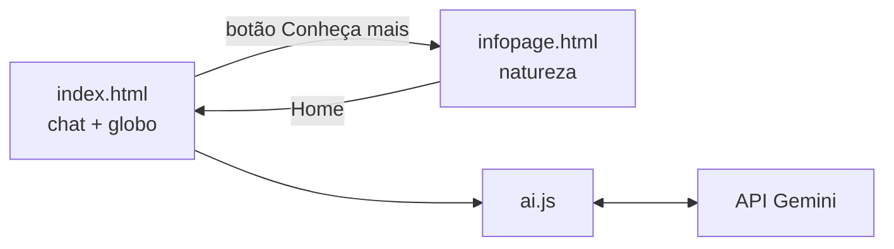
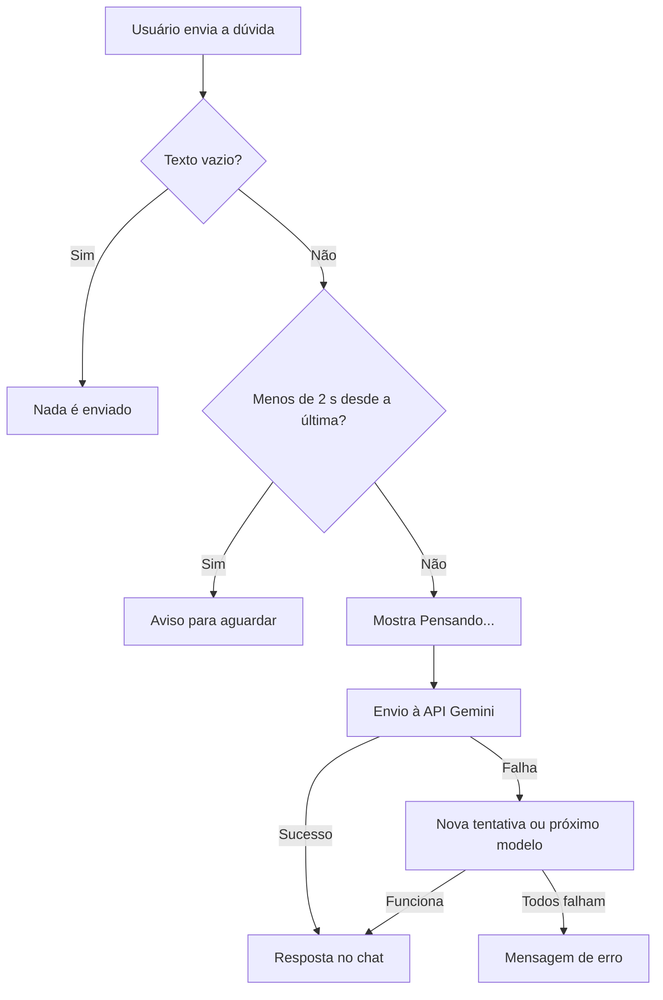
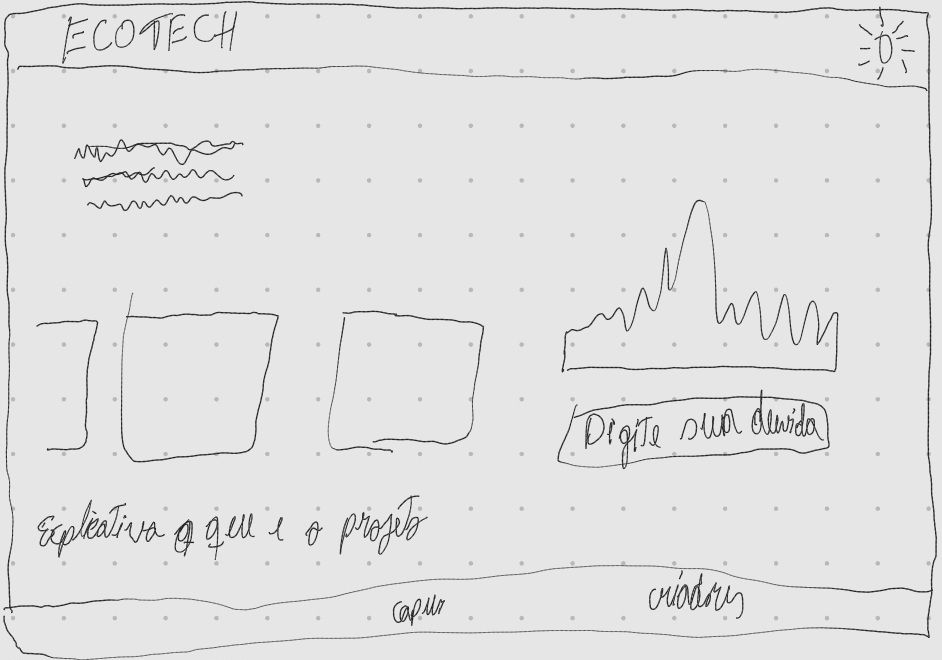

<div align="center">

# 🌱 EcoTech

**Plataforma educativa que responde dúvidas sobre meio ambiente com inteligência artificial**

`HTML · CSS · JavaScript puro · sem build`

**[🌐 Abrir a versão web](https://briandevbr.github.io/Ecotech/)**

</div>

---

O **EcoTech** é uma plataforma web de educação ambiental que utiliza inteligência artificial para tornar o conhecimento sobre sustentabilidade mais acessível. Por meio de um chat, o usuário esclarece dúvidas sobre temas como reciclagem, preservação e mudanças climáticas, com um assistente orientado a responder em linguagem clara e educativa. A experiência é complementada por um globo interativo e por uma página dedicada à natureza, com o propósito de incentivar práticas sustentáveis no dia a dia.

---

## 📑 Sumário

- [🎯 Problema](#-problema)
- [💡 Solução](#-solução)
- [✅ Objetivos](#-objetivos)
- [👥 Público-alvo](#-público-alvo)
- [✨ Funcionalidades](#-funcionalidades)
- [💬 Exemplos de perguntas](#-exemplos-de-perguntas)
- [🔄 Como funciona](#-como-funciona)
- [📋 Requisitos](#-requisitos)
- [📰 Regras de negócio](#-regras-de-negócio)
- [⚙️ Tecnologias](#️-tecnologias)
- [🗂️ Estrutura do projeto](#️-estrutura-do-projeto)
- [🗄️ Modelo de dados](#️-modelo-de-dados)
- [🎨 Protótipo](#-protótipo)
- [🚀 Como executar](#-como-executar)
- [🚧 Limitações](#-limitações)

---

## 🎯 Problema

Nem sempre é fácil encontrar informação ambiental simples e confiável.

## 💡 Solução

O EcoTech reúne em uma página um assistente com inteligência artificial especializado em meio ambiente. A pessoa escreve a dúvida com as próprias palavras e recebe uma explicação em português acessível, com exemplos do dia a dia e formas práticas de ajudar.

## ✅ Objetivos

- Responder dúvidas sobre meio ambiente.
- Divulgar informações sobre reciclagem e preservação.
- Incentivar práticas sustentáveis.

## 👥 Público-alvo

Estudantes, professores, famílias e todos os interessados em sustentabilidade.

## ✨ Funcionalidades

- [x] Chat com IA focado em temas ambientais
- [x] Mensagens separadas entre usuário e EcoTech
- [x] Mensagens de erro em português
- [x] Globo interativo
- [x] Página sobre a natureza com animação de abertura
- [x] Layout adaptado para celular e computador
- [ ] Botão "Menu" da página sobre a natureza
- [ ] Botão de tema e área dos criadores, previstos no wireframe
- [ ] Servidor intermediário para proteger a chave
- [ ] Corrigir o ícone SVG do cabeçalho da página sobre a natureza

**Progresso: 6 de 10 itens da lista**

## 💬 Exemplos de perguntas

- "Como separar o lixo reciclável em casa?"
- "O que são mudanças climáticas?"
- "Como economizar água no dia a dia?"
- "Onde devo descartar pilhas usadas?"

Perguntas fora do tema ambiental devem ser recusadas com educação pelo assistente.

## 🔄 Como funciona

### Navegação



### Caminho de uma pergunta



### Proteções do chat

| Proteção | Como funciona |
|---|---|
| Modelos alternativos | `gemini-3.8-flash`, `gemini-3.5-flash-lite` e `gemini-flash-latest`, nessa ordem |
| Nova tentativa | Em erro 429 ou 503, espera 1,5 s e tenta o mesmo modelo mais uma vez |
| Contexto limitado | Envia no máximo as 8 mensagens mais recentes |
| Resposta limitada | Até 600 tokens, com temperatura 0,7 |
| Antispam | Intervalo de 2 segundos entre perguntas |
| Erros amigáveis | Traduz os códigos 400, 403, 429 e 503 para português |

## 📋 Requisitos

### Funcionais

- **RF01:** permitir que o usuário envie uma pergunta.
- **RF02:** exibir a pergunta e a resposta no chat.
- **RF03:** recusar, com educação, perguntas fora do tema ambiental (por instrução à IA).
- **RF04:** mostrar mensagens de erro compreensíveis.
- **RF05:** permitir o acesso à página sobre o meio ambiente.

### Não funcionais

- **RNF01:** interface em português e de uso simples.
- **RNF02:** layout adaptável a celular e computador.
- **RNF03:** intervalo mínimo de 2 segundos entre perguntas.

## 📰 Regras de negócio

- **RN01:** responder apenas sobre meio ambiente e sustentabilidade.
- **RN02:** usar português claro, acessível e educativo.
- **RN03:** relacionar a explicação com exemplos do dia a dia e formas de ajudar.
- **RN04:** recusar com educação perguntas fora do tema.
- **RN05:** não inventar dados e avisar quando não tiver certeza.

Essas regras são instruções enviadas à IA, que pode não segui-las sempre.

## ⚙️ Tecnologias

- [HTML5](https://developer.mozilla.org/pt-BR/docs/Web/HTML): estrutura das duas páginas
- [CSS3](https://developer.mozilla.org/pt-BR/docs/Web/CSS): Grid, Flexbox, media queries e animações com `@keyframes`
- JavaScript puro: chat, [Fetch API](https://developer.mozilla.org/pt-BR/docs/Web/API/Fetch_API) e animações
- [API Gemini](https://ai.google.dev/): respostas do assistente
- [three-globe](https://github.com/vasturiano/three-globe): globo exibido por `iframe`
- [Google Fonts](https://fonts.google.com/): Bodoni Moda e Montserrat na página sobre a natureza
- [GitHub Pages](https://pages.github.com/): hospedagem
- Git e GitHub: versionamento
- [Prettier](https://prettier.io/): formatação do código

## 🗂️ Estrutura do projeto

| Caminho | Descrição |
|---|---|
| `index.html` | Página inicial: apresentação, objetivos, chat, globo e botão para a página sobre o meio ambiente |
| `style.css` | Estilos da página inicial: tema escuro, mensagens do chat e layout em duas colunas a partir de 768px |
| `assets/infopage.html` | Página sobre a natureza, com galeria de três fotos e texto |
| `assets/infopage.css` | Estilos e animações de abertura dessa página |
| `assets/js/ai.js` | Lógica do chat e comunicação com a API Gemini |
| `assets/js/config-exemple.js` | Modelo do arquivo de configuração da chave |
| `assets/js/infopage.js` | Dispara as animações quando a página carrega |
| `assets/images/` | Fotos, logo e wireframe |
| `.prettierrc` | Padrão de formatação do código |
| `.gitignore` | Impede o envio do `config.js` |

### Árvore de arquivos

```
🗂️ Ecotech
├── 📁 assets
│   ├── 📁 images
│   │   ├── 📁 logo
│   │   │   └── 🖼️ logo.png
│   │   ├── 📁 wireframes
│   │   │   └── 🖼️ homePage.jpg
│   │   ├── 🖼️ img1.jpg
│   │   ├── 🖼️ img2.jpg
│   │   └── 🖼️ img3.jpg
│   ├── 📁 js
│   │   ├── ⚙️ ai.js
│   │   ├── ⚙️ config-exemple.js
│   │   └── ⚙️ infopage.js
│   ├── 🎨 infopage.css
│   └── 🌐 infopage.html
├── 🔧 .gitignore
├── 🔧 .prettierrc
├── 🌐 index.html
└── 🎨 style.css
```

## 🗄️ Modelo de dados

O projeto não usa banco de dados. O histórico fica na memória do navegador e some ao recarregar a página.

| Campo | Tipo | Valores | Para que serve |
|---|---|---|---|
| `role` | texto | `"user"` ou `"model"` | Indica quem escreveu |
| `parts[].text` | texto | conteúdo da mensagem | Pergunta ou resposta |

```js
{ role: "user", parts: [{ text: "Como separar o lixo reciclável?" }] }
```

<sub>Exemplo ilustrativo do formato.</sub>

## 🎨 Protótipo



## 🚀 Como executar

**Só quer ver?** Abra a [versão web](https://briandevbr.github.io/Ecotech/). O chat só responde se a publicação tiver uma configuração de chave.

**Quer rodar e mexer no código?** Você precisa do [Git](https://git-scm.com/downloads), de um navegador e de uma chave do [Google AI Studio](https://aistudio.google.com/).

```bash
git clone https://github.com/briandevbr/Ecotech.git
cd Ecotech
cp assets/js/config-exemple.js assets/js/config.js
```

Depois, coloque sua chave em `assets/js/config.js` e abra o `index.html` no navegador.

> [!WARNING]
> Nunca envie o `config.js` para o GitHub. Em um site só com front-end, a chave usada no navegador pode ser vista por quem acessa.

## 🚧 Limitações

- O chat depende de internet, de uma chave válida e dos limites de uso da API.
- As respostas são geradas por IA e podem conter erros. Confira informações importantes em fontes oficiais.
- O globo depende de um site externo.

---

<div align="center">
  <sub>Feito pelo time EcoTech 💚 · 2º período de ADS · UNINASSAU Olinda</sub><br/>
  <sub>Pergunte → Aprenda → Preserve</sub>
</div>
